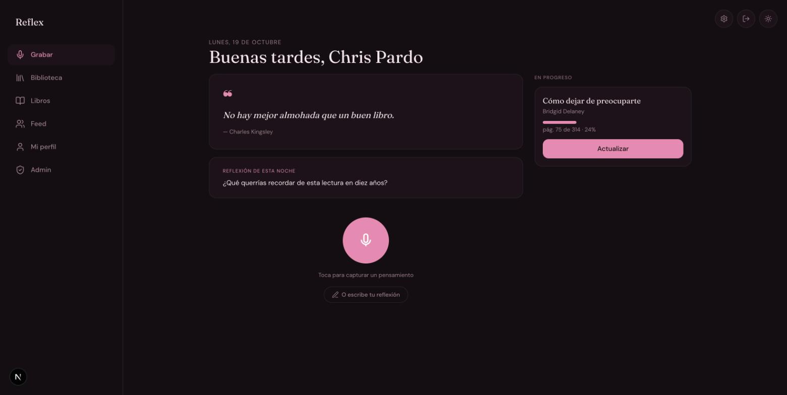
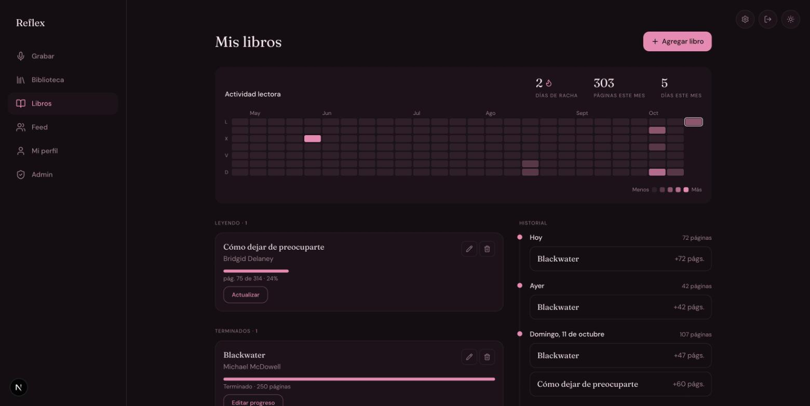
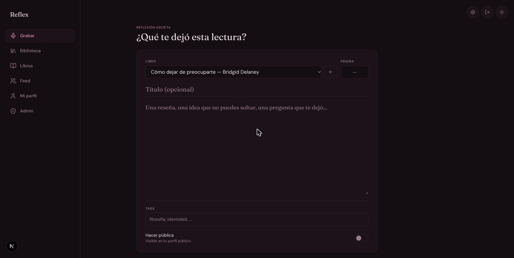
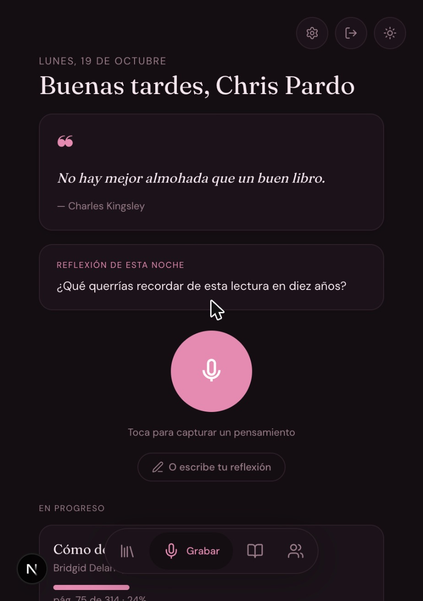
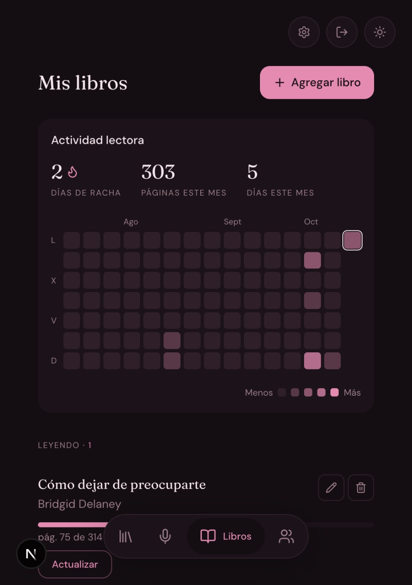

# Reflex

Diario de lectura personal (PWA). Graba reflexiones de voz o escríbelas mientras lees, guarda citas textuales y sigue tu progreso por libro con un historial de páginas y un mapa de actividad.

<p align="center">
  
</p>

## Funcionalidades

- **Reflexiones de voz o escritas**: graba manteniendo presionado el micrófono (con vista previa antes de guardar) o escribe una reflexión o reseña. En ambos casos puedes vincularla a un libro y una página, y ponerle tags.
- **Citas textuales**: fragmentos destacados con tu interpretación.
- **Público o privado desde el inicio**: cada reflexión o cita se puede marcar como pública al crearla; aparece en tu perfil público (`/feed/[id]`).
- **Mis libros**: progreso por libro separado en *Leyendo* y *Terminados*. Al terminar un libro se celebra el momento y se ofrece escribir una reseña.
- **Historial de lectura**: qué leíste cada día, de qué página a cuál (ej. *pág. 187 → 230*). Si corriges una página a la baja, el registro del día se ajusta.
- **Mapa de actividad**: 6 meses en escritorio y 4 en móvil, con racha, páginas y días leídos este mes. Si tocas un día, el historial se filtra.
- **Feed y perfiles**: autores destacados (curados por admin), buscador por nombre y perfil público con muro cronológico.
- **Admin** (`/admin/users`): destacar y verificar usuarios.
- **Temas**: claro/oscuro y paleta "Rosa", combinables.

## Capturas

| Mis libros (escritorio) | Reflexión escrita |
| --- | --- |
|  |  |

| Inicio (móvil) | Mis libros (móvil) |
| --- | --- |
|  |  |

## Stack

Next.js 16 (App Router, Turbopack) · React 19 · TypeScript · Tailwind CSS v4 · Framer Motion · SWR · Supabase (Postgres, Auth, Storage) · `@ducanh2912/next-pwa` (desactivado en desarrollo).

## Estructura

```
src/
  app/            Rutas: / (inicio), /library, /books, /feed, /feed/[authorId],
                  /admin/users, /login, /auth/callback
  components/     Componentes de UI (formularios, tarjetas, sheets, heatmap, historial…)
  lib/hooks/      Un hook SWR por dominio (useBooks, useReflections, useQuotes,
                  useReadingLogs, …). Cada uno hace sus consultas a Supabase y
                  actualizaciones optimistas; no hay capa de API aparte.
  lib/supabase/   Clientes de Supabase para navegador y servidor
  lib/date.ts     Fecha local (YYYY-MM-DD) para registros de lectura
  types/          Tipos compartidos
supabase/         schema.sql completo + migraciones incrementales (ver supabase/README.md)
docs/screenshots/ Capturas usadas en este README
```

## Desarrollo local

```bash
npm install
npm run dev        # http://localhost:3000
npm run build      # build de producción
npm run lint
```

Crea un `.env.local`:

```
NEXT_PUBLIC_SUPABASE_URL=https://xxxxx.supabase.co
NEXT_PUBLIC_SUPABASE_ANON_KEY=eyJ...
```

La configuración de la base de datos (esquema, migraciones, storage y auth) está en [`supabase/README.md`](supabase/README.md).

> **Ojo:** `.env.local` apunta al proyecto real de Supabase; no hay base de staging. Ten cuidado con las acciones destructivas al probar.

Si los cambios de CSS dejan de aparecer tras una sesión larga de `next dev`, la caché de Turbopack quedó vieja: `pkill -f "next dev"; rm -rf .next; npm run dev`.

## Historial de cambios

Ver [`CHANGELOG.md`](CHANGELOG.md).
